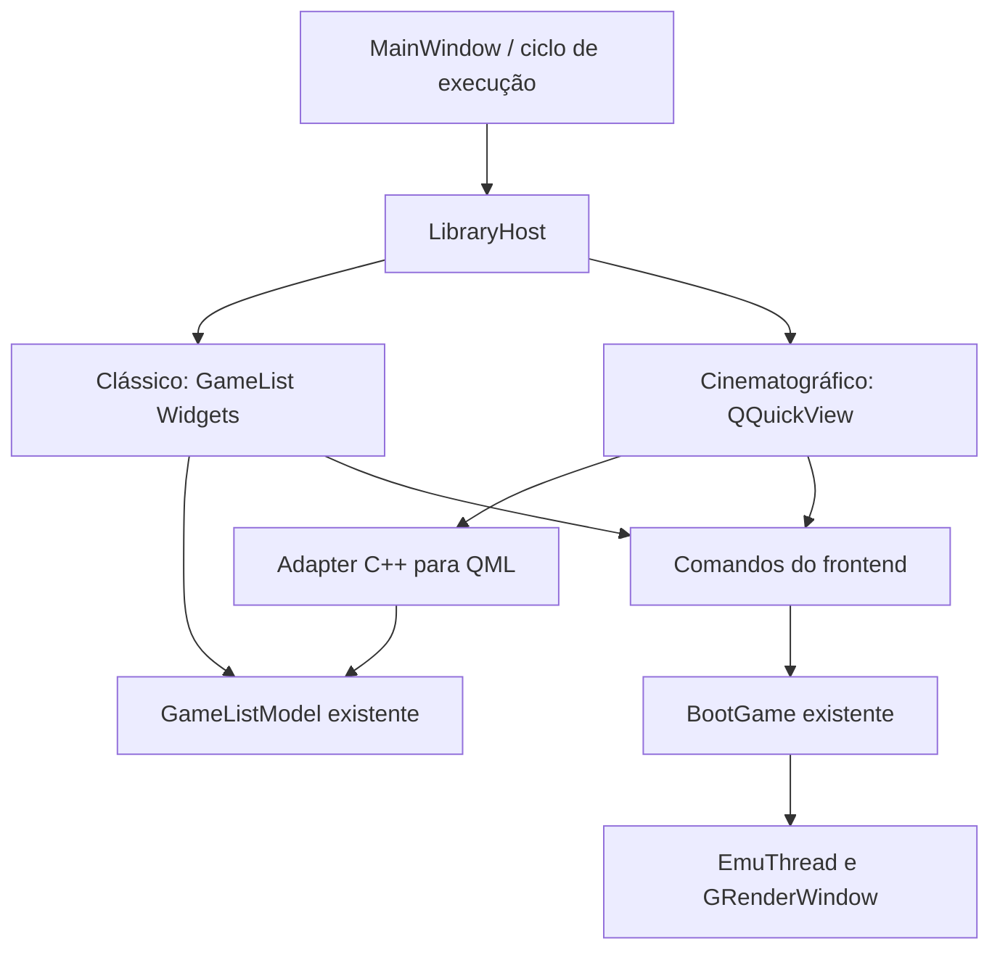
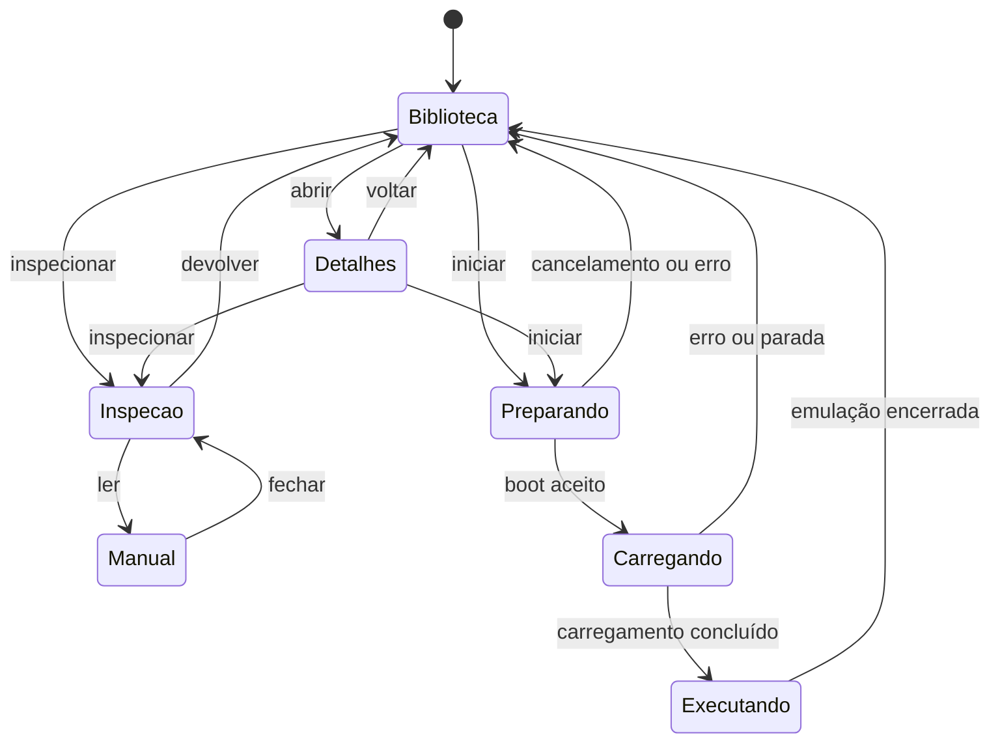

> Documento histórico de pesquisa, elaborado em 12/11/2026 sob o título “Fritchii Cinematic UI”. O nome atual é **Hakas-Fritchii_MOD**.
>
> O conteúdo abaixo foi preservado. Afirmações sobre o estado da entrega ou ausência de consulta ao Gemini descrevem aquela data. O vídeo, os quadros e o pacote mencionados não estão incluídos neste repositório. Para as decisões posteriores e correções, consultar [DECISOES.md](DECISOES.md), [WINDOWS.md](WINDOWS.md) e [ROADMAP.md](ROADMAP.md).

# Fritchii Cinematic UI — pesquisa, arquitetura e plano de implementação

**Responsável pelo projeto:** Cassiano Gualberto  
**Data:** 12/11/2026  
**Entrega:** planejamento técnico e visual, anterior à implementação. Nenhum repositório remoto foi alterado.

## 1. Decisão recomendada

É tecnicamente viável acrescentar uma interface cinematográfica nativa ao Fritchii usando **C++ para integração e dados, Qt Quick/QML para composição e Qt Quick 3D para as caixas**. A interface original em Qt Widgets permanece como layout Clássico. As duas usam a mesma instância do modelo de biblioteca, os mesmos caminhos de inicialização e os mesmos serviços do emulador.

A recomendação de hospedagem é começar com **QQuickView dentro de QWidget::createWindowContainer**, como uma página inteira e opaca da biblioteca. A composição cinematográfica, inclusive detalhes, menus e avisos próprios, fica dentro do QML. Comparar com QQuickWidget num protótipo pequeno antes de fixar essa decisão: QQuickWidget facilita a composição com Widgets, mas acrescenta renderização intermediária e desativa o render loop em thread separado. A alternativa com janela nativa exige cuidado com foco e sobreposição. Nenhuma das duas foi validada em execução nesta pesquisa.

O trabalho preserva Core::System, EmuThread, GRenderWindow, renderizadores Vulkan/OpenGL, saves, controles emulados e configurações por jogo. Não há Electron, WebEngine para desenhar a nova UI nem processo de launcher.

**Fidelidade é um critério de aceitação, não uma propriedade já demonstrada.** O resultado depende de comparar capturas do protótipo com o vídeo, ajustar projeção e materiais e dispor de arte com qualidade suficiente. Ícones quadrados existentes não substituem automaticamente as capas verticais do vídeo.

## 2. Fontes e grau de certeza

| Fonte | Branch examinada | Commit congelado |
|---|---|---|
| [Fritchii](https://github.com/Frizti/Fritchii) | nx2, padrão | f66ea633db6058efe31a9611718019e5bd1667eb |
| [BoxShelf source](https://github.com/sassiestrhihno/boxshelf-source) | main | 068ef313d8a24e4a7ac8f9fb94e8055066216afa |
| [BoxShelf beta](https://github.com/sassiestrhihno/boxshelf-beta) | main | 043d6b7cf5cf3456251ab04b4eeb046062459940 |

O vídeo prioritário é `ssstwitter.com_1794507683945.mp4`: **60,8 segundos, 640 × 360, 60 quadros/s**, SHA-256 registrado em `evidencias.json`. Foram inspecionadas folhas de quadros a cada 0,5 s entre 0 e 32 s e a cada 2 s no restante, além de uma visão geral. Os tempos de eventos são aproximados; em geral, a resolução de observação é ±0,25 s no primeiro trecho. Não houve análise de áudio.

Convenções usadas nesta especificação:

- **V — vídeo:** comportamento observado na gravação.
- **C — código:** valor ou mecanismo encontrado no snapshot atual.
- **P — proposta:** decisão ou parâmetro inicial da recriação.
- **N — não confirmado:** exige protótipo, medição adicional ou referência complementar.

O código atual do BoxShelf declara versão **1.82.0-beta.12**. Não há prova de que o vídeo use essa mesma versão. A gravação mostra um painel lateral de detalhes com vizinhos ainda visíveis; `details2.css` descreve um redesenho que oculta os vizinhos e muda a composição. **O layout do vídeo prevalece sobre esse redesenho.**

A árvore do repositório beta contém documentação e distribuição, sem implementação de renderer. O repositório source contém o código relevante. A leitura de repositórios foi feita com o acesso GitHub e com cópias locais dos commits para buscas precisas.

## 3. Arquitetura real do Fritchii

### 3.1 Frontend e componentes

| Arquivo/componente confirmado | Função atual | Consequência para a nova UI |
|---|---|---|
| `src/yuzu/main_window.cpp` e `.h` | MainWindow herda QMainWindow; cria biblioteca, carregamento e janela de renderização | Continua sendo o coordenador do ciclo de execução |
| `src/yuzu/main.ui` | Formulário da janela, menus e layout de Widgets | Recebe a escolha Clássico/Cinematográfico; não precisa ser refeito |
| `src/yuzu/game/game_list.cpp` e `.h` | GameList é QWidget; possui as três views e um modelo | Pode continuar proprietário do modelo durante a primeira implementação |
| `src/yuzu/game/carousel.cpp` e `.h` | GameCarousel herda QListView, usa delegate GameCard e fluxo horizontal sem quebra | É um carrossel 2D de Widgets, sem câmera 3D |
| `src/qt_common/game_list/model.cpp` e `.h` | GameListModel herda QStandardItemModel; discovery, favoritos e atualização de diretórios | Fonte de dados a reaproveitar, sem um segundo scanner |
| `src/qt_common/game_list/worker.cpp` | Leitura assíncrona dos arquivos, ícone e título, conteúdo instalado | A UI nova observa os resultados desse trabalho |
| `src/qt_common/game_list/game_list_p.h` | Tipos de linha e roles dos itens | Permite distinguir jogo, diretório, favoritos e adicionar pasta |
| `src/qt_common/config/uisettings.h` e `qt_config.cpp` | Estado de UI, diretórios, favoritos, recentes e persistência | Local apropriado para a preferência de frontend |
| `src/frontend_common/play_time_manager.*` | Tempo acumulado por program ID, leitura/escrita de playtime.bin | Reutilizar; não criar outro contador de tempo |
| `src/yuzu/util/controller_navigation.*` | HID existente convertido em eventos de teclado | Base de integração; insuficiente por si só para inspeção livre |
| `src/yuzu/bootmanager.*` | GRenderWindow e superfícies nativas OpenGL/Vulkan | Não substituir pela View3D |
| `src/yuzu/loading_screen.*` | Progresso de carregamento e shaders, fade e sinal Hidden | Fonte de progresso real e de liberação da janela do jogo |

`InitializeWidgets()` cria `GRenderWindow`, `GameList`, `GameListPlaceholder` e `LoadingScreen`. O modelo também é passado ao componente de multiplayer; substituir o modelo inteiro pode afetar esse consumidor.

### 3.2 Alternância de visualização existente

`Settings::GameListMode` tem **TreeView, GridView e CarouselView**. `MainWindow::SetGameListMode()` persiste `UISettings::values.game_list_mode` e chama `GameList::ResetViewMode()`.

O ponto delicado é que `ResetViewMode()` altera a forma do modelo: árvore para TreeView e lista plana para Grid/Carousel, com repopulação quando essa forma muda. O modelo de árvore inclui diretórios e uma pasta de favoritos com clones de jogos. Uma UI QML que simplesmente enumere as linhas da raiz perde jogos da árvore; uma que percorra tudo sem deduplicação repete favoritos.

Também foi encontrado que `GameList::OnTextChanged()` encaminha o filtro para a árvore ou para `grid_view`; não encaminha explicitamente para `carousel_view`, embora essa classe tenha ApplyFilter. Não foi executado para confirmar o efeito visível. O adapter novo deve ter filtragem própria sobre os mesmos critérios de busca, sem depender da ocultação de linhas de uma view clássica.

### 3.3 Inicialização e retorno

Fluxo confirmado da ativação normal:

1. `GameList::ValidateEntry()` verifica tipo, caminho e existência; trata diretório com arquivo `main`.
2. Emite `GameChosen(game_path, title_id)`.
3. `ConnectWidgetEvents()` conecta a `MainWindow::OnGameListLoadFile()`.
4. Esse slot constrói ApplicationAppletParameters com o program ID e chama `BootGame()`.
5. `BootGame()` preserva verificações, configurações globais/por jogo, seleção de usuário e carregamento; cria/inicia EmuThread.
6. O progresso vai a LoadingScreen. O sinal Hidden da tela de carregamento permite mostrar/focar GRenderWindow.
7. `OnEmulationStopped()` restaura a biblioteca e o estado de UI.

Há também `GameList::BootGame` → `BootGameFromList(filename, StartGameType)`, usado para opções específicas de configuração. Não substituir a ativação normal por esse atalho sem preservar a escolha do program ID.

`BootGame()` retorna **void** e possui vários retornos antecipados, inclusive por cancelamento/falha. `EmulationStarting()` ocorre depois de LoadROM, portanto não é um aviso de começo de toda a tentativa. A nova tela precisa de notificações explícitas de tentativa aceita/cancelada/falha para não ficar presa num overlay. Isso é uma pequena integração no frontend, sem reescrever o boot.

Existem manipulações diretas de `game_list` no boot, no retorno, em `OnGameListShowList()` e em `ToggleWindowMode()`. Todas precisam passar a considerar a página ativa da biblioteca. O modo de renderização em janela separada deve continuar funcionando.

### 3.4 Dados existentes e dados ausentes

| Dado | Situação constatada | Tratamento planejado |
|---|---|---|
| Nome, program ID, caminho, tipo | Roles existentes no modelo | Reutilizar |
| Ícone | DecorationRole com QPixmap escalado pelo tamanho da view | Fallback; procurar a origem/cache de maior resolução ao implementar |
| Atualizações/add-ons e tamanho | Colunas e discovery existentes | Reutilizar quando disponíveis |
| Favoritos | UISettings e GameListModel | Um único estado; encaminhar alterações ao dono existente |
| Tempo jogado | PlayTimeManager::GetPlayTime, Start, Stop | Ler em pontos seguros, após parada; evitar leituras concorrentes sem verificar sincronização |
| Arquivos recentes | UISettings::values.recent_files | Compartilhar; representa arquivos usados, não histórico completo de sessões |
| Última sessão, quantidade de execuções | Não encontrados nos componentes examinados | Omitir esses campos inicialmente; extensão futura compartilhada, se necessária |
| Capa frontal vertical, lombada, verso | Não encontrados como catálogo de arte do frontend atual | Novo catálogo visual opcional, por jogo |
| Trailer, fundo hero, manual | Não encontrados como serviço da biblioteca atual | Assets locais opcionais; não anunciar que já existem |
| Sinopse, nota, ano e gênero | Não confirmados como catálogo rico nos componentes examinados | Campos opcionais; ausências não viram valores inventados |

Program IDs são `u64`. No limite C++/QML, expô-los como **strings hexadecimais de 16 caracteres**, evitando perda de precisão em números JavaScript.

## 4. Como o BoxShelf produz o visual

| Parte | Implementação encontrada | O que portar conceitualmente |
|---|---|---|
| Carrossel | `renderer/app.js` e `style.css`; caixas com faces HTML, preserve-3d, perspective e transforms | Poses e projeção, espaçamento, seleção e interpolação |
| Brilho e escurecimento | Gradientes e camadas CSS; glare se desloca conforme ângulo/posição | Reflexo especular estilizado e contraste dos vizinhos |
| Reflexo de chão | `setup.css`: box-reflect da frente selecionada, máscara em gradiente | Reflexo visual simples, sem exigir um espelho fisicamente correto |
| Detalhes | app.js, style.css e redesenho details2.css | Usar a composição lateral observada no vídeo |
| Caixa inspecionável | inspect3d.js usa Three.js; inspect.css oferece fallback CSS | Geometria arredondada, dobradiça, mídia, manual e voo desde a estante |
| Modelos opcionais | model.js carrega GLTF/GLB de consoles personalizados; museum.js trata outro modo | Não são requisito do carrossel visto no vídeo |
| Fundos | Camadas com crossfade, themefx.js, themes-extra.js, imagens e previews opcionais | Arte por jogo, vinheta, cor e efeitos moderados |
| Entrada no jogo | bootslide.css, insert.css, app.js; launcher lança emuladores externos | Recriar a tela e ligá-la ao boot interno do Fritchii |
| Mídias e metadados | covers.js, main/, shared/, arquivos locais e serviços externos | Aproveitar estrutura conceitual, sem importar toda a infraestrutura |

O snapshot não contém arquivos `.glb`, `.gltf`, `.obj` ou `.fbx` na árvore examinada. A geometria principal de inspeção é construída por código. O README informa que o modelo de PC do modo museu não está incluído. Não planejar a importação de modelos que não estão no repositório.

A câmera Three.js de inspeção tem FOV vertical 30°, posição (0,0,3.9), near 0.2 e far 12. A câmera do modelo opcional de console tem FOV 28° e outra pose; **não confundir com a câmera da biblioteca**.

A biblioteca CSS usa perspective de 1800 px e origem em 50% da largura/42% da altura. É possível reproduzir a aparência com um renderizador diferente; não é necessário portar o motor DOM ou Three.js.

## 5. Especificação visual baseada no vídeo

### 5.1 Linha do tempo observada

| Tempo aproximado | Observação V | Requisito de recriação |
|---|---|---|
| 0–1 s | Zelda selecionado, Pokémon à direita; fundo florestal; HUD fino e piso com reflexo | Estado base da estante |
| 1–3 s | Seleção vai para Pokémon e retorna; capas trocam profundidade e orientação; fundo acompanha com atraso/crossfade | Movimento contínuo e interrupção fluida |
| 3–10 s | Painel de detalhes entra pela direita; estante se desloca à esquerda; trailer e imagens no painel | Cena e painel animados juntos; seleção preservada |
| 10–12,5 s | Detalhes saem; caixa é destacada para inspeção; entorno escurece e desfoca | Continuidade de pose e escala, sem salto de objeto |
| 12,5–14,5 s | Caixa gira e abre pela lombada; interior vermelho e cartucho aparecem | Malha com tampa articulada e pivô correto |
| 14,5–16,5 s | Livreto: capa vertical e páginas internas em dupla, fundo escuro | Leitor de páginas com transição de entrada/saída |
| 16,5–18,5 s | Retorno à caixa, fechamento e volta aos detalhes/estante | Retorno contextual, sem perder o jogo selecionado |
| 18,5–24,5 s | Troca de categoria para PC, navegação por muitas caixas e retorno a Switch 2 | Referência de densidade e oclusão com muitos itens |
| 24,5–26,7 s | Biblioteca novamente; aparece um seletor de versão/build antes do play | No Fritchii usar apenas escolhas realmente existentes; não copiar seleção de emulador externo |
| 26,7–32,7 s | Tela vermelha, formas claras entram e se encontram; capa à esquerda, título/plataforma à direita e linha de progresso | Componente de transição/boot da própria aplicação |
| Cerca de 33–35 s | Tela preta de preparação de shaders, contador e estimativa | Reaproveitar progresso verdadeiro do Fritchii |
| Cerca de 35–56 s | Preto, depois cena noturna do jogo surge gradualmente | Conteúdo/tempo de carregamento do jogo, não coreografia obrigatória da UI |
| Cerca de 57–60,8 s | Logo e menu do jogo | A UI já deve ter entregue controle ao renderizador |

A gravação não mostra retorno após encerrar o jogo nem o menu de escolha entre os nossos dois layouts. Esses comportamentos são P, não observações do vídeo. A presença de caixas de PC na referência não significa que este projeto ampliará os sistemas emulados pelo Fritchii.

### 5.2 Composição da biblioteca

**V:** a caixa selecionada domina o centro, à frente das demais; tem leve yaw, espessura e lombada visíveis. As laterais recuam e giram, formando uma estante densa. A seleção não é apenas uma imagem 2D ampliada. Há halo colorido, reflexão curta no chão, vinheta forte, título branco abaixo e uma faixa pequena de comandos junto ao rodapé.

**P:** desenhar em coordenadas lógicas de referência 1920 × 1080, com escala pela altura e margens de segurança ajustáveis. O vídeo de 640 × 360 é uma gravação reduzida; não sabemos a resolução da janela original. Medir proporções no quadro e manter o arquivo de referência com sua resolução original.

| Região | Alvo visual inicial P | Observação |
|---|---|---|
| Centro da estante | x = 0.50W, y ≈ 0.42H | Confirmado também pelo CSS atual C |
| Caixa selecionada | Altura projetada em torno de 0.46–0.50H | Estimativa visual; calibrar quatro cantos |
| Título | Região de 0.72–0.77H | Centralizado sob a caixa, sem encostar no reflexo |
| Identidade da categoria | Canto superior esquerdo | Duas linhas com hierarquia forte/fraca |
| Abas | Centro superior | Cápsula discreta; item ativo claro |
| Status/contador | Canto superior direito | Informação secundária, baixo peso visual |
| Comandos | Região de 0.94–0.97H | Faixa compacta, glifos legíveis na resolução final |
| Detalhes | Cerca do último 1/3 da largura | Não copiar a largura bruta de 460 px para o vídeo reduzido |

A câmera não deve orbitar a cada seleção: o efeito dominante vem do deslocamento/rotação das caixas. Para detalhes, mover e reduzir o grupo da estante. Para inspeção, mover a caixa em relação à tela/câmera e escurecer a biblioteca.

### 5.3 Geometria e projeção reproduzível

Os parâmetros C do estilo `sw2` são: largura/altura **0.612**, profundidade/largura **0.096**, margem da arte **0.035 da largura**, cor da caixa `#e60012`, lateral `#ad000d`. O estilo `sw` tem as mesmas proporções principais com outra paleta.

No modo desktop do código atual, altura base `h = min(0.4H, 0.22W/0.612, limite)`, limite 620 com efeitos ou 520 sem efeitos. Abaixo de 760 px o código usa outra regra. Como a captura pode ter sido reduzida, escolher os parâmetros pela aparência, não tratar 640 como a largura da janela fonte.

Poses C da função `place()`, usando `w` como largura base e `t` como espessura:

| Distância do selecionado d | x | z | yaw CSS |
|---|---|---|---|
| 0 | 0 | 1.05w | +22° |
| d ≠ 0 | sign(d) × [1.22w + (abs(d)−1) × (0.22w + 0.9t)] | −0.7w − 6abs(d) | −60° × sign(d) |

**P:** começar com câmera em z=1800 unidades e a geometria em unidades equivalentes aos pixels lógicos de referência. A projeção CSS tem distância focal 1800. Para uma perspectiva centralizada de altura H, FOV vertical equivalente é `2 atan(H/(2×1800))`; em H=1080 isso dá aproximadamente **33,4°**. A origem de projeção em 42% da altura precisa de **frustum assimétrico**, ou outra transformação de projeção equivalente. Só usar FOV 33,4° com câmera centralizada em 50% da altura não reproduz a cena.

Com eixos Qt em Y para cima e câmera olhando −Z, um ponto inicial de FrustumCamera, near n, é: left=−0.5Wn/1800, right=+0.5Wn/1800, top=0.42Hn/1800, bottom=−0.58Hn/1800. Verificar o sinal do yaw e as convenções das malhas; o critério é mostrar a mesma lombada que o vídeo. Distância focal e posições mudam juntas ao trocar a unidade de escala.

Para a inspeção, usar uma segunda configuração de câmera/pose com FOV 30°, inspirada no código C; casar primeiro a projeção da caixa de origem, depois interpolar para a pose de inspeção. Não reaproveitar de forma literal unidades em metros da inspeção Three.js dentro da cena em pixels lógicos.

### 5.4 Materiais, luz, reflexos e fundos

**P para estante:** capa em textura sRGB preservando as cores; borda plástica vermelha com relevo discreto; lombada separada; faixa especular suave com deslocamento dependente da pose. Evitar exposição/bloom que deixe a arte lavada. Os vizinhos devem ficar mais escuros, seguindo o escurecimento aproximado de 34% encontrado no CSS, sem forçar a mesma aparência em materiais PBR não equivalentes.

O reflexo do vídeo é estilizado. Começar com uma representação espelhada da frente selecionada, com máscara de opacidade e desaparecimento para baixo. Não gastar inicialmente com reflexos de toda a cena. Conferir oclusão e orientação no pivô do piso; um simples plano branco brilhante não reproduz o resultado.

**C para inspeção:** ambiente de sala com intensidade 0.45; key branca 1.55 em (2,3,4), rim azulada 0.55 em (−3,1,−2), fill quente 0.6 em (−2,−1,3); saída sRGB e tone mapping Neutral. Esses valores são referências de Three.js, não intensidades diretamente intercambiáveis com Qt. **P:** ajustar luzes e materiais Qt pela imagem final. Usar ambiente próprio/neutro, sem depender de um asset inexistente no snapshot.

**V:** fundos ocupam toda a tela, acompanham o jogo e perdem presença sob detalhes/inspeção. **C:** as camadas de fundo têm crossfade de 800 ms; há imagens e previews opcionais no projeto. **P:** suportar imagens locais com recorte cover, duas camadas de crossfade e vinheta; background em vídeo fica opcional após confirmar custo e módulos. Não afirmar que a arte florestal da gravação é um arquivo de vídeo: essa origem não foi comprovada.

### 5.5 Caixa articulada e livreto

Criar malha leve própria de caixa fechada, lombada, contracapa, interior, tampa com dobradiça na lateral e cartucho. Usar frente/verso/lombada independentes. Na inspeção, adicionar espessura e cantos arredondados visíveis; separar a face impressa do plástico para evitar z-fighting.

**C:** o pivô da tampa chega a −165° no renderer Three.js. A abertura usa suavização exponencial com constante 4.2/s, seguida de easing cúbico; não é um tween linear com duração fixa. O cartucho é coerente com o sistema do vídeo; não inserir um disco por padrão só porque o código suporta outros sistemas.

O livreto aparece como objeto/página com capa e depois uma dupla de páginas claras. O código pode gerar um booklet a partir de metadados quando falta um manual. **P:** suportar páginas locais pré-renderizadas e, se desejado, um livreto gerado claramente identificado como ficha do jogo. Sem dados reais, usar uma ficha mínima, sem inventar sinopse ou autoria. PDF em tempo de execução é uma escolha posterior; não está confirmada uma dependência Qt PDF no Fritchii.

### 5.6 Catálogo de animações

Valores C são do snapshot atual; validar cada um no vídeo antes de congelar a versão final. Valores V são intervalos aproximados observados, não medições de curva por quadro.

| Ação | Referência C | Implementação P |
|---|---|---|
| Navegação entre caixas | Transform 550 ms, Bézier (0.22,0.9,0.25,1); opacidade 400 ms | Interromper do estado corrente, sem reiniciar na pose antiga |
| Girar frente/verso | 750 ms, Bézier (0.3,0.95,0.25,1) | Rotação contínua, sem salto em ±180° |
| Escurecimento lateral | 450 ms | Mesmo relógio da seleção |
| Brilho que percorre a capa | 850 ms; modo Less espera 1400 ms | Efeito opcional de chegada; não repetir por troca de textura |
| Halo respirando | 3.4 s ease-in-out | Parar quando a biblioteca ficar oculta |
| Troca de fundo | Crossfade 800 ms; atualização desktop agendada em torno de 120 ms | Cancelar atualização atrasada de jogo anterior |
| Abrir detalhes | Painel 550 ms; cena 600 ms, x −17vw e escala 0.92 no estilo anterior | Sincronizar painel/estante; manter os vizinhos como no vídeo |
| Entrar em inspeção | Voo de origem: 560 ms; easing cúbico in/out | Ocultar caixa da estante só quando a caixa inspecionável estiver pronta |
| Sair da inspeção | Voo para estante: 440 ms | Fechar durante o retorno, aterrissar na pose atual |
| Abrir caixa | Suavização 4.2/s e tampa até −165° | Intervalo visual de cerca de 0.6–1.0 s como alvo inicial; calibrar, não tratar como medido |
| Livreto | V: sequência visível aproximadamente 14.5–16.5 s | Separar tempo de interação do usuário e tempo da animação; este último ainda N |
| Início vermelho | Fundo 500 ms; formas 550 ms; capa 900 ms com atraso 950 ms; texto 800 ms com atraso 1100 ms no estilo Switch | Executar sobre o boot interno sem bloquear eventos nem impor espera artificial |
| Linha do boot | C: 3.8 s decorativos + pulsação | Substituir por progresso real quando houver; indeterminado nas etapas sem total |
| Reduce motion | C: voo de inspeção vira transição de 180 ms | Configuração própria; manter foco/estado e evitar zoom/voos longos |

Usar um token por transição/seleção para descartar callbacks atrasados. Se o usuário mantiver direita/esquerda, retargetar a animação, não acumular uma fila de 550 ms por jogo.

## 6. Arquitetura proposta dos dois layouts

### 6.1 Separar frontend de visualização clássica

Adicionar uma preferência nova **FrontendMode { Classic, Cinematic }**. Não reaproveitar `GameListMode` para isso. O Clássico continua lembrando Tree/Grid/Carousel exatamente como hoje; voltar ao Clássico restaura essa preferência.

`LibraryHost`, um QWidget com QStackedWidget, apresenta a página clássica ou a página cinematográfica. Na fase inicial, GameList continua vivo e proprietário de GameListModel, mesmo quando sua página está oculta. A posse pode ser extraída depois, se isso reduzir acoplamento, sem tornar essa refatoração condição para o primeiro visual.

As setas da biblioteca indicam acesso lógico; o ownership inicial do modelo permanece em GameList. O diagrama não propõe um segundo serviço de emulação.

### 6.2 Contrato C++/QML

**CinematicGameModel**, um QAbstractListModel, projeta o modelo existente. Percorre árvore ou lista, ignora diretórios/AddDir, deduplica clones de favoritos e mantém identificação estável. Roles propostos:

| Role | Tipo/semântica |
|---|---|
| gameKey | String estável: program ID e caminho canônico; fallback por caminho para ID zero |
| programIdHex | String hexadecimal; nunca double |
| title, fileType | Strings vindas do modelo |
| iconUrl, frontUrl, backUrl, spineUrl, backdropUrl | URLs de image provider/arquivo local aprovado |
| favorite | Estado derivado de UISettings/modelo |
| playTimeSeconds | Valor do serviço existente em ponto seguro |
| hasArtwork, hasManual, canLaunch | Capacidades reais, sem conteúdo fictício |

O adapter não deve chamar SetFlat para facilitar o QML: respeita a forma atual escolhida pelo clássico. Observar rowsInserted, rowsRemoved, dataChanged, modelReset e layoutChanged, inclusive eventos dos pais. Ao fim de repopulação, restaurar seleção por gameKey. QPersistentModelIndex ajuda entre alterações, mas não sobrevive a reset; resolver novamente pelo identificador.

Reutilizar critérios de `Yuzu::FilterMatches` onde apropriado, extraindo-os se necessário; não depender do estado `setRowHidden()` de uma view. Estado visual de ordenação e busca pode ser mantido pelo host, sem modificar arquivos de jogo.

**FrontendActions**, QObject, oferece comandos tipados: escolher jogo, iniciar, abrir propriedades existentes, configurar emulador/controles, alternar layout, atualizar biblioteca. Os nomes são P. Não expor Core::System inteiro ou execução arbitrária de comandos ao QML.

Para a ativação, preferir uma entrada pública controlada em GameList que resolve a seleção e reutiliza ValidateEntry; isso preserva diretórios com `main` e o encaminhamento de program ID. O bridge emite o pedido para o coordenador C++, que revalida o item imediatamente antes do boot. `BootGame`, privado hoje, não precisa virar invokable de QML.

**CinematicAssetStore**, serviço visual novo e compartilhável, resolve arte por gameKey/program ID, com arquivo de metadados versionado e cache em diretório de dados/cache da aplicação. Layout Clássico pode continuar usando apenas os ícones, mas não manterá cópias independentes dos metadados novos. Sem scraping automático no primeiro marco. Importar arte local, validar formato/tamanho e limitar decodificação.

### 6.3 Hospedagem e alternativas

| Opção | Vantagem | Limite relevante | Decisão |
|---|---|---|---|
| QQuickView + createWindowContainer | Cena Quick nativa; evita a penalidade específica de QQuickWidget | Janela opaca sobre Widgets; foco e modais exigem prova | Preferida para página inteira, sujeita ao protótipo |
| QQuickWidget | Integração simples no layout Widgets; composição mais flexível | Passe extra e render loop sem thread separado; atenção à API gráfica da janela | Plano alternativo se o custo medido for aceitável |
| Qt Quick com transformações 2.5D | Próximo do mecanismo CSS do carrossel | Caixa articulada, luz e profundidade real exigem trabalho adicional | Possível perfil reduzido; não entrega sozinho toda a referência |
| Qt Quick 3D + QML | Câmeras, malhas, materiais, luz, animação e overlays 2D numa composição | Módulos e empacotamento novos; exige GPU compatível | Tecnologia visual recomendada |
| QGraphicsView/QPainter | Reaproveita Widgets | Perspectiva e plástico/caixa exigem renderer próprio ou aproximações | Não escolher para o objetivo completo |
| Renderer C++ OpenGL próprio | Controle fino | Mais código gráfico, shaders e suporte de drivers para manter | Só se Quick 3D falhar num requisito demonstrado |
| Qt 3D | Pode representar cenas 3D | Introduz outro conjunto de abstrações; integração precisa ser demonstrada | Não há benefício comprovado sobre Quick 3D para este escopo |

Todos os overlays da página nativa ficam no próprio QML. Para diálogos existentes, usar janelas modais transitórias corretamente parentadas e testar ordem/foco. Não presumir que um QWidget irmão ficará visível sobre o container nativo.

### 6.4 Controles e foco

Hoje ControllerNavigation fornece principalmente direções, Enter e Escape e bloqueia navegação de biblioteca durante emulação. Não fornece diretamente todo o conjunto de botões, repetição sustentada e rotação analógica do BoxShelf.

Manter uma única rota de comandos de biblioteca. Generalizar o despacho de GameList para o host/bridge; desativar o destinatário oculto. Não instalar dois leitores HID que disparem a mesma ação.

| Ação proposta | Teclado P | Controle P |
|---|---|---|
| Navegar | Setas esquerda/direita | D-pad ou analógico esquerdo |
| Iniciar | Enter | Botão de confirmar conforme mapeamento do emulador |
| Voltar/fechar painel | Esc | Botão de voltar |
| Detalhes | I | Ação dedicada, ex.: X na convenção Nintendo |
| Inspecionar | V | Clique do analógico direito |
| Girar capa | F; arrastar | Ação dedicada e analógico direito |
| Abrir/fechar caixa | Enter na inspeção, por contexto | Confirmar no contexto de inspeção |
| Manual | M no contexto da caixa | Ação contextual indicada no rodapé |

São mapeamentos iniciais, não uma leitura dos botões físicos usados no vídeo. Os rótulos devem seguir Nintendo/Xbox/PlayStation conforme o controle, sem alterar o mapeamento dos jogos. O M de manual vale na inspeção; a biblioteca não terá o museu do BoxShelf neste escopo.

Tratar press/release, deadzone, histerese, repetição sustentada, desconexão e troca de dispositivo. P inicial para repetição: 350 ms antes de repetir e 120 ms entre passos, ajustável após comparação; não medido no vídeo. Callbacks HID são encaminhados à thread da UI via queued connection. Ao perder foco ou abrir modal, zerar estado de teclas/botões; ao fechar, exigir release para impedir ativação repetida.

### 6.5 Estados e transferência para o jogo

Guardar a origem da inspeção: se veio dos detalhes, voltar aos detalhes do mesmo item. O diagrama simplifica esse retorno contextual.

Não copiar a espera fixa do launcher externo. A animação de apresentação pode começar antes de BootGame, após deixar um frame ser desenhado, mas o boot existente contém trechos síncronos: **não está garantido que a UI anime suavemente durante todo LoadROM**. Medir esse bloqueio no protótipo; usar frame estático de carregamento se necessário, sem processEvents reentrante e sem mover Core para outra thread improvisadamente.

Adicionar sinais/resultados de tentativa de boot no frontend e ligação ao progresso de EmuThread. Cancelamento na seleção de usuário/configuração retorna à biblioteca. `OnLoadComplete`/Hidden continuam comandando a apresentação da janela do jogo, respeitando o fluxo atual. Se for adicionado futuramente um aviso de primeiro frame, ele deve vir do frontend/renderizador existente; não inventar um sinal que já existiria.

Durante a execução, pausar animações, previews e decodificação; liberar assets pesados conforme orçamento. No modo janela separada, a biblioteca pode permanecer visível, mas com visual estático e ações incompatíveis bloqueadas. Ao terminar, restaurar layout, seleção, foco e tempo atualizado. Nenhum save é copiado, movido ou convertido pela UI.

## 7. Build, dependências e licenças

### 7.1 Estado atual confirmado

- CMake mínimo **3.31** e C++ **20**.
- Target do frontend continua chamado `yuzu`; o workflow também usa artefatos identificados como Lichii. O nome do repositório não exige renomear esses targets nesta fase.
- Componentes Qt obrigatórios na configuração: Core, Widgets, Charts, Concurrent, Gui e Network; DBus em Linux/FreeBSD.
- Multimedia e WebEngine são opções; não presumir que estejam ativos ou instalados.
- Não foram encontradas ligações de Qml, Quick, QuickWidgets ou Quick3D na configuração examinada do frontend.
- Qt empacotado: `AddQt(Eden-CI/Qt 6.11.1)`. Workflow de releases Windows/Linux: Qt **6.8.3**, instalando explicitamente `qtcharts`. macOS usa `qt@6` via Homebrew, sem versão fixa nesse trecho.
- A presença dos novos módulos no pacote binário empacotado **não foi inspecionada**. Não inferir presença só pela versão.

### 7.2 Alterações planejadas

Adicionar opção de build `ENABLE_CINEMATIC_UI`, inicialmente OFF para desenvolvimento conservador. Com ON, exigir os módulos **Qml, Quick e Quick3D** da mesma instalação Qt; **QuickControls2** se os controles escolhidos o exigirem. **QuickWidgets** só no experimento/implementação QQuickWidget. Multimedia apenas se o marco de trailers/vídeo for incluído. Não usar WebEngine para esta interface.

Adotar **Qt 6.8.3 como base de compatibilidade inicial**, pois corresponde aos releases existentes. Conferir também a opção empacotada 6.11.1, sem trocar silenciosamente a versão global. APIs adicionadas depois da base precisam de alternativa ou requisito explícito.

Incluir QML em recursos com `qt_add_qml_module` no target adequado e URI própria; conferir geração/registro dos tipos C++, import scanner e tratamento de recursos. Selecionar malhas e materiais com APIs públicas disponíveis na base; não depender de tipos internos privados do Qt.

O fluxo atual de Windows chama windeployqt sem `--qmldir`. Acrescentar descoberta dos imports da pasta QML e verificar os módulos de Quick 3D, controles e shaders usados. Atualizar instalação CI dos módulos necessários e o empacotamento Linux/macOS. macdeployqt também precisa conhecer o diretório QML quando aplicável; remover o plugin de teclado virtual opcional, como hoje, não equivale a disponibilizar o restante do QML.

Uma compilação OFF não deve exigir os módulos novos. Uma compilação ON com dependência ausente deve falhar na configuração com mensagem clara. Um pacote já compilado com dependências obrigatórias faltantes pode falhar antes de executar código de fallback; portanto, o retorno ao Clássico por erro de cena **não substitui** um pacote completo.

### 7.3 Inventário de licenças

| Componente | Evidência | Consequência para o planejamento |
|---|---|---|
| Fritchii | LICENSE.txt contém GPLv3; arquivos novos do frontend têm GPL-3.0-or-later; há cabeçalhos herdados GPL-2.0-or-later | Preservar avisos e proveniência dos arquivos |
| BoxShelf | package.json: GPL-3.0-only; LICENSE contém GPLv3 | Tradução/adaptação de código deve manter atribuições e observar a licença |
| Three.js / meshoptimizer | MIT nos notices e arquivos vendor | Não são dependências da implementação Qt proposta |
| PDF.js | Apache-2.0 | Não é necessário para o primeiro leitor de páginas locais |
| Fontes listadas pelo BoxShelf | SIL OFL 1.1; textos em renderer/fonts/LICENSES | Verificar a licença de cada fonte que for distribuída |
| Qt Quick 3D | Documentação oficial: GPLv3 ou comercial | Não tratá-lo como módulo disponível sob LGPL apenas |
| Artes, logos, manuais e modelos externos | Notices distinguem conteúdo de terceiros; modelos podem vir do usuário | A licença do código não é autorização geral para redistribuir esses assets |

O projeto Qt proposto pode ser desenvolvido como derivação aberta mantendo o regime aplicável. Antes de publicar binários, montar um inventário por arquivo/dependência e os respectivos avisos/fontes correspondentes. Não foi feita auditoria jurídica completa de todas as dependências transitivas nem dos assets da gravação.

## 8. Estrutura de implementação sugerida

Nomes abaixo são P, não arquivos já existentes:

| Arquivo/pasta | Responsabilidade |
|---|---|
| `src/yuzu/cinematic/library_host.*` | Página ativa, visibilidade, foco e fallback |
| `src/yuzu/cinematic/cinematic_game_model.*` | Projeção do modelo e roles QML |
| `src/yuzu/cinematic/frontend_actions.*` | Comandos limitados e integração de boot/configuração |
| `src/yuzu/cinematic/asset_store.*` | Manifesto, image provider, importação e cache |
| `src/yuzu/cinematic/qml/CinematicLibrary.qml` | Cena raiz e estados |
| `.../ShelfScene.qml`, `GameCase.qml` | Projeção e caixas da estante |
| `.../DetailsPanel.qml` | Painel observado no vídeo |
| `.../InspectScene.qml`, `ManualReader.qml` | Caixa aberta e páginas |
| `.../LaunchOverlay.qml`, `ControllerHints.qml` | Transição para boot e comandos |
| `.../assets/`, `.../shaders/` | Geometria original, materiais e máscaras necessários |

Integrações existentes a alterar: main_window.*, main.ui, UISettings/QtConfig e eventual enum de frontend; CMake raiz e do target; controller_navigation/dispatch; pontos de visibilidade e LoadingScreen. Não editar CPU, GPU, HLE ou shaders dos jogos para fazer UI.

A preferência salva só contém o modo e ajustes visuais próprios. Esconder menus/status no modo cinematográfico não deve sobrescrever as preferências originais do Clássico. Restaurar também a barra de filtro e geometria apropriadas ao voltar.

## 9. Desempenho, falhas e manutenção

**Metas P, ainda sem benchmark:** 60 fps na navegação em 1080p numa máquina alvo definida; p95 de frame ≤16.7 ms, p99 ≤33.3 ms em cenário aquecido; resposta visual ao comando em até 100 ms. Separar primeira abertura, cache quente e decodificação. Não inferir desempenho a partir do vídeo reduzido.

Começar com até 15 caixas ativas (selecionado e sete de cada lado), ampliável quando a comparação mostrar necessidade. Renderizar bordas visíveis com baixo custo; não carregar toda a biblioteca em malhas/texturas. Testar 500–1000 entradas, preservando quantidade visual constante.

Usar texturas proporcionais ao tamanho projetado, mipmaps, cache LRU e limite de concorrência. P inicial: 96 MiB para texturas da UI em 1080p, 192 MiB em 4K; medir e revisar. Uma textura RGBA8 de 1024×2048 ocupa 8 MiB sem mipmaps, cerca de 10.7 MiB com a cadeia completa, o que mostra por que não se deve carregar dezenas de capas nessa resolução. Contabilizar render targets, buffers e recursos Qt separadamente.

Perfis P: Alto preserva efeitos completos; Equilibrado reduz resolução/qualidade dos efeitos; Reduzido retira reflexo, previews e brilho caro. Não chamar o perfil Reduzido de reprodução fiel sem comparação. O backend de software do Qt Quick não suporta conteúdo Quick 3D; fallback nessa situação é Clássico, ou uma UI 2D explicitamente distinta.

Criar a cena sob demanda e suspender quando oculta. Não presumir que `visible=false` libera memória. Verificar destruição de View3D/engine/recursos, persistência do scene graph e custo de recriação. O QML não deve ficar consultando o sistema de arquivos a cada frame.

Erros de import QML, textura inválida, device loss e inicialização gráfica devem levar ao Clássico com um aviso claro e acesso à configuração. Guardar um marcador de inicialização incompleta para que a próxima abertura possa oferecer Clássico; CLI de recuperação é uma adição futura, não opção existente confirmada. Não interceptar sinais fatais de driver como se toda falha fosse recuperável.

## 10. Plano incremental e critérios de conclusão

| Marco | Implementação | Critério para avançar |
|---|---|---|
| M0 — base reproduzível | Congelar commits; compilar Fritchii original; inventariar Qt do PC/CI; preparar dados sintéticos | Build original e inicialização clássica funcionando no ambiente alvo |
| M1 — prova de integração | Página Quick mínima, uma caixa sem assets de terceiros, troca de layout, foco e modal; comparar hosts | Trocas repetidas sem tela preta, foco perdido ou conflito com renderizador Vulkan/OpenGL |
| M2 — biblioteca compartilhada | Adapter árvore/plano, seleção estável, filtro/favoritos e comando de boot | Mesmos jogos nos dois modos; um scanner, um boot e nenhuma duplicação |
| M3 — fidelidade da estante | Malha, projeção, poses, reflexo, halo, fundo e timings | Quadros base e de navegação comparados ao vídeo |
| M4 — detalhes e inspeção | Painel lateral da gravação, caixa articulada, cartucho e leitor | Origem/destino coerentes; não perder seleção; assets faltantes tratados |
| M5 — execução e retorno | Overlay vermelho, progresso real, cancelamento, parada e restauração | Nenhum overlay preso; mesmo save/configuração/tempo pelo boot original |
| M6 — distribuição | Imports QML, DLLs/plugins, pacotes e licenças | Instalação limpa sem Qt de desenvolvimento; builds ON e OFF válidos |

Não começar por refatoração ampla do emulador. Cada marco deve resultar num commit pequeno e revisável; decidir entre QQuickView e QQuickWidget em M1 usando evidência de desempenho e comportamento.

## 11. Validação funcional e visual

### Funcional

- Alternar Classic/Cinematic partindo de Tree, Grid e Carousel; voltar ao mesmo modo clássico. Repetir trocas e reiniciar a aplicação.
- Biblioteca vazia, pastas indisponíveis, leitura em andamento, modelo em árvore e plano, favoritos duplicados, IDs iguais em caminhos diferentes e ID zero.
- Busca, atualização de pastas e remoção de item durante detalhes/inspeção; nenhuma referência de modelo inválida.
- Boot pelo arquivo da biblioteca, diretório com `main` e conteúdo instalado; configurações por jogo e seleção de usuário preservadas.
- Cancelar a seleção de usuário, ROM indisponível, falha de carregamento e tentativa duplicada de iniciar.
- Pausar, parar, reiniciar e executar subprograma; janela única/separada, tela cheia, Alt+Tab, minimizar e DPI diferente entre monitores.
- Controle conectado/desconectado, input mantido, teclado/mouse alternados e fechamento de modal; uma ação por intenção, sem vazamento para o jogo.
- Saves e configuração observados antes/depois em perfil de teste; tempo acumulado pelo gerenciador existente, sem contador paralelo.
- Build OFF sem QML; ON com todos os imports; pacote limpo sem SDK Qt e sem acesso à rede.

### Visual

Usar a gravação original para comparação, com os mesmos assets quando fornecidos/licenciados. Para a distribuição e testes automatizados, usar imagens de teste originais. Capturar o resultado na mesma proporção 16:9 e reduzir a 640×360 para avaliar a composição; também inspecionar 1080p/4K para nitidez e serrilhado.

Quadros de referência: 0.5 s (biblioteca Zelda), 1.5 s (Pokémon), 4.0 s (detalhes), 11.0 s (inspeção fechada), 14.0 s (caixa aberta), 16.0 s (livreto), 22.5 s (densidade PC como referência geométrica), 28.5 s (boot vermelho).

Medir quatro cantos da caixa e posição do título, borda esquerda do painel, horizonte do reflexo, origem dos brilhos e ordem de oclusão. P inicial de tolerância: desvio de pontos principais ≤2% da altura do quadro e tempos de transição dentro de ±10% ou ±50 ms, o maior. Esses limites são metas de engenharia para revisão, não promessa de identidade pixel a pixel.

Comparar também quadros intermediários a 25/50/75% do movimento: estados finais iguais não garantem a mesma animação. Ajustar easing pelo movimento, sem aplicar pixel diff cru sobre trailers, partículas ou fundos em movimento. As diferenças da arte e da tipografia devem ser discriminadas das diferenças de geometria.

### Estado desta entrega

Foi concluída **pesquisa estática dos pontos principais, leitura do vídeo e desenho técnico**. Não foi compilado ou executado o Fritchii/BoxShelf, não foi implementada a cena e não há resultado de testes de compatibilidade ou desempenho. Os arquivos de planejamento e o pacote foram verificados quanto a consistência, referências e integridade do arquivo compactado.

## 12. Questões abertas que o protótipo deve resolver

1. QQuickView/WindowContainer mantém foco e modais confiáveis nos sistemas alvo? Se não, QQuickWidget atende à meta medida?
2. Quais módulos estão efetivamente presentes no Qt empacotado 6.11.1? O usuário compilará com Qt 6.8.3 ou outra instalação?
3. Qual o bloqueio da thread de UI durante BootGame/LoadROM? Quanto da animação pode rodar antes do boot sem reentrância?
4. Como reaproveitar imagens em resolução adequada sem depender do DecorationRole já reduzido?
5. Quais diferenças de silhueta e brilho persistem ao reproduzir CSS 3D em Quick 3D?
6. O usuário fornecerá capas completas, fundos e manual? Sem isso, uma parte importante da fidelidade de conteúdo permanece indisponível.
7. O vídeo foi gravado com quais opções de efeitos/zoom/versão? Isso não foi identificado.

Essas perguntas não impedem M0/M1; não justificam inventar respostas ou redesenhar o core.

## 13. Pacote para o Gemini

Foi procurada integração Gemini entre as ferramentas disponíveis e no catálogo de plugins: nenhuma integração utilizável foi encontrada nesta sessão. **Não houve consulta ao Gemini e não há parecer dele incorporado ao plano.**

`Prompt_Gemini_Fritchii_Cinematic_UI.md` é autossuficiente: inclui contexto técnico, achados, descrição temporal do vídeo, parâmetros, arquitetura e perguntas. Enviar esse texto junto ao vídeo. Se o vídeo não for enviado, a revisão só poderá avaliar a especificação textual; não poderá atestar fidelidade visual.

A resposta deverá separar observação do vídeo, fatos do código, propostas e incertezas; citar APIs Qt 6.8 e explicar diferenças de materiais/projeção. Depois da revisão, incorporar apenas recomendações verificadas no código/documentação e atualizar a decisão de hospedagem a partir do protótipo.

## 14. Referências auditáveis

Links imutáveis aos arquivos examinados:

- [MainWindow: inicialização, boot, retorno e visualizações](https://github.com/Frizti/Fritchii/blob/f66ea633db6058efe31a9611718019e5bd1667eb/src/yuzu/main_window.cpp)
- [Declarações de MainWindow](https://github.com/Frizti/Fritchii/blob/f66ea633db6058efe31a9611718019e5bd1667eb/src/yuzu/main_window.h)
- [GameList e suas views](https://github.com/Frizti/Fritchii/blob/f66ea633db6058efe31a9611718019e5bd1667eb/src/yuzu/game/game_list.cpp)
- [Carrossel atual](https://github.com/Frizti/Fritchii/blob/f66ea633db6058efe31a9611718019e5bd1667eb/src/yuzu/game/carousel.cpp)
- [Modelo compartilhado](https://github.com/Frizti/Fritchii/blob/f66ea633db6058efe31a9611718019e5bd1667eb/src/qt_common/game_list/model.cpp)
- [Tipos e roles](https://github.com/Frizti/Fritchii/blob/f66ea633db6058efe31a9611718019e5bd1667eb/src/qt_common/game_list/game_list_p.h)
- [Tempo jogado](https://github.com/Frizti/Fritchii/blob/f66ea633db6058efe31a9611718019e5bd1667eb/src/frontend_common/play_time_manager.cpp)
- [UISettings](https://github.com/Frizti/Fritchii/blob/f66ea633db6058efe31a9611718019e5bd1667eb/src/qt_common/config/uisettings.h)
- [QtConfig](https://github.com/Frizti/Fritchii/blob/f66ea633db6058efe31a9611718019e5bd1667eb/src/qt_common/config/qt_config.cpp)
- [Controles de biblioteca](https://github.com/Frizti/Fritchii/blob/f66ea633db6058efe31a9611718019e5bd1667eb/src/yuzu/util/controller_navigation.cpp)
- [LoadingScreen](https://github.com/Frizti/Fritchii/blob/f66ea633db6058efe31a9611718019e5bd1667eb/src/yuzu/loading_screen.cpp)
- [CMake principal](https://github.com/Frizti/Fritchii/blob/f66ea633db6058efe31a9611718019e5bd1667eb/CMakeLists.txt)
- [CMake do frontend](https://github.com/Frizti/Fritchii/blob/f66ea633db6058efe31a9611718019e5bd1667eb/src/yuzu/CMakeLists.txt)
- [Workflow de distribuição](https://github.com/Frizti/Fritchii/blob/f66ea633db6058efe31a9611718019e5bd1667eb/.github/workflows/release-binaries.yml)
- [Licença do Fritchii](https://github.com/Frizti/Fritchii/blob/f66ea633db6058efe31a9611718019e5bd1667eb/LICENSE.txt)
- [BoxShelf: app.js](https://github.com/sassiestrhihno/boxshelf-source/blob/068ef313d8a24e4a7ac8f9fb94e8055066216afa/renderer/app.js)
- [BoxShelf: style.css](https://github.com/sassiestrhihno/boxshelf-source/blob/068ef313d8a24e4a7ac8f9fb94e8055066216afa/renderer/style.css)
- [BoxShelf: setup.css e reflexos](https://github.com/sassiestrhihno/boxshelf-source/blob/068ef313d8a24e4a7ac8f9fb94e8055066216afa/renderer/setup.css)
- [BoxShelf: inspect3d.js](https://github.com/sassiestrhihno/boxshelf-source/blob/068ef313d8a24e4a7ac8f9fb94e8055066216afa/renderer/inspect3d.js)
- [BoxShelf: details2.css](https://github.com/sassiestrhihno/boxshelf-source/blob/068ef313d8a24e4a7ac8f9fb94e8055066216afa/renderer/details2.css)
- [BoxShelf: bootslide.css](https://github.com/sassiestrhihno/boxshelf-source/blob/068ef313d8a24e4a7ac8f9fb94e8055066216afa/renderer/bootslide.css)
- [BoxShelf: dependências e licença](https://github.com/sassiestrhihno/boxshelf-source/blob/068ef313d8a24e4a7ac8f9fb94e8055066216afa/package.json)
- [BoxShelf: avisos de terceiros](https://github.com/sassiestrhihno/boxshelf-source/blob/068ef313d8a24e4a7ac8f9fb94e8055066216afa/THIRD-PARTY-NOTICES.md)

Documentação primária consultada do Qt, na família 6.8:

- [QQuickWidget: performance, APIs e limitações](https://doc.qt.io/qt-6.8/qquickwidget.html)
- [QWidget::createWindowContainer: foco e sobreposição](https://doc.qt.io/qt-6.8/qwidget.html#createWindowContainer)
- [QQuickView](https://doc.qt.io/qt-6.8/qquickview.html)
- [Qt Quick 3D: módulo, build e licença](https://doc.qt.io/qt-6.8/qtquick3d-index.html)
- [Requisitos gráficos e seleção de API](https://doc.qt.io/qt-6.8/qtquick3d-requirements.html)
- [PerspectiveCamera e orientação do FOV](https://doc.qt.io/qt-6.8/qml-qtquick3d-perspectivecamera.html)

